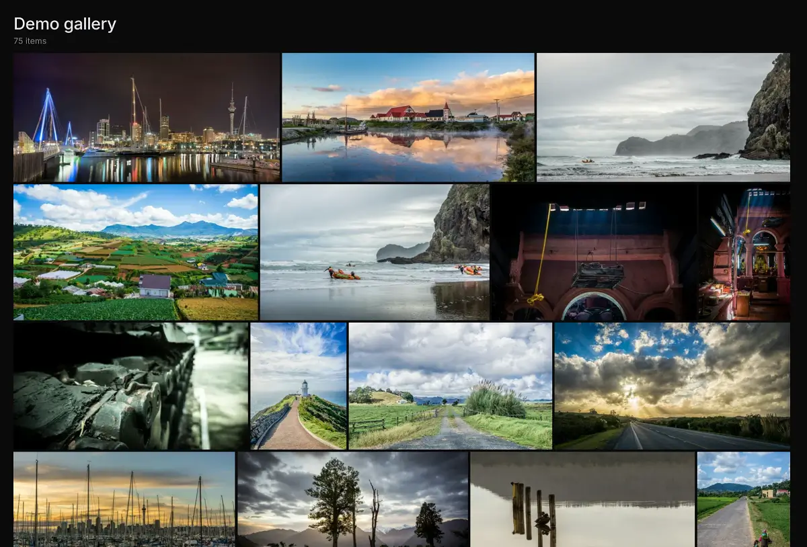

# Immich Public Proxy

<p align="center" width="100%">

</p>

<p align="center" width="100%">
<a href="https://hub.docker.com/r/alangrainger/immich-public-proxy/tags">
    </a>
<a href="https://github.com/alangrainger/immich-public-proxy/releases/latest">
    </a>
<a href="https://demo.ipp.nz/s/demo-gallery"></a>
</p>

Share your Immich photos and albums in a safe way without exposing your Immich instance to the public.

👉 See a [Live demo gallery](https://demo.ipp.nz/s/demo-gallery)
serving straight out of my own Immich instance.

Setup takes less than a minute, and you never need to touch it again as all of your sharing stays managed within Immich.

<p align="center" width="100%">

</p>

## About this project

[Immich](https://github.com/immich-app/immich) is a wonderful bit of software, but since it holds all your private photos it's
best to keep it fully locked down. This presents a problem when you want to share a photo or a gallery with someone.

**Immich Public Proxy** provides a barrier of security between the public and Immich, and _only_ allows through requests
which you have publicly shared. It is stateless, needs no API key, and knows nothing about your Immich instance beyond
what you have shared.

Read more in the [Introduction](https://docs.ipp.nz/introduction), including
[why not just expose Immich's `/share/` path](https://docs.ipp.nz/introduction#why-not-expose-immich-directly).

### This fork

This is a personal fork ([pinkfloydFR/immich-public-proxy-gps](https://github.com/pinkfloydFR/immich-public-proxy-gps)) of the
project above, adding GPS/location metadata support: coordinates as a clickable OpenStreetMap link, plus an interactive map of
geotagged photos below the gallery. See [GPS / Location feature](#gps--location-feature) and
[Building the image locally](#building-the-image-locally) below.

## Quick start

1. Download the [docker-compose.yml](https://github.com/alangrainger/immich-public-proxy/blob/main/docker-compose.yml) file.
2. Set `IMMICH_URL` to the local (not public) URL of your Immich server, and `PUBLIC_BASE_URL` to the public URL of IPP.
3. Run `docker-compose up -d` and check that `https://your-proxy-url.com/share/healthcheck` responds.
4. In Immich's **Server Settings**, set the "External domain" to your IPP URL. Every link Immich generates from now on
   points at the proxy.

If you use Cloudflare, set your `/share/video/*` path to Bypass Cache or videos may not play.

Full instructions, including Kubernetes: **[Installation](https://docs.ipp.nz/installation)**.

## Documentation

Everything is at **[docs.ipp.nz](https://docs.ipp.nz)**:

- [Installation](https://docs.ipp.nz/installation) and [Sharing from Immich](https://docs.ipp.nz/how-to-use)
- [Configuration](https://docs.ipp.nz/config/): downloads, gallery layout, lightbox, metadata privacy, error responses
- Guides: [single domain with Immich](https://docs.ipp.nz/running-on-single-domain),
  [redirect your root domain to a share](https://docs.ipp.nz/redirect-root-to-share),
  [securing Immich with mTLS](https://docs.ipp.nz/securing-immich-with-mtls)
- [Troubleshooting](https://docs.ipp.nz/troubleshooting)

The sections below cover this fork's own additions, which aren't part of the upstream docs site.

### GPS / Location feature

When `ipp.showMetadata.location.gps` is enabled, photos that include GPS metadata expose their coordinates in the info
sidebar, link them to [OpenStreetMap](https://www.openstreetmap.org/), and appear on an interactive map below the gallery.

To enable the GPS feature in the current config format:

```json
{
  "ipp": {
    "showMetadata": {
      "location": {
        "gps": true,
        "webLink": true
      }
    }
  }
}
```

Legacy boolean configs from the older GPS fork are still accepted during startup via migration and are mapped to the
modern shape automatically, so an old `"location": true` still works for the GPS flag.

> **Note**: Photos without GPS EXIF data are simply skipped; they do not get a location row and do not appear on the map.
> On album shares, the map fills progressively while per-asset metadata is fetched.

See [config.explained.md](config.explained.md) for this fork's full annotated `config.json` reference.

### Building the image locally

If you want to run a locally modified version (e.g. after cloning this fork), build the Docker image yourself instead of
pulling from Docker Hub:

```bash
git clone https://github.com/pinkfloydFR/immich-public-proxy-gps.git
cd immich-public-proxy-gps
./rebuild-image.sh
```

This builds `immich-public-proxy-gps:local`. The top-level `docker-compose.yml` in this repo already points its `build:`
directive at this directory, so `docker-compose up -d --build` picks it up directly.

## Feature requests

You can [add feature requests here](https://github.com/alangrainger/immich-public-proxy/discussions/categories/feature-requests?discussions_q=is%3Aopen+category%3A%22Feature+Requests%22+sort%3Atop),
however my goal with this project is to keep it as lean as possible.

IPP has **read-only** access to Immich and stores nothing: anything that needs an API key, modifies Immich, or would
require storing a share key won't be considered. See [CONTRIBUTING.md](CONTRIBUTING.md) for the full list.
